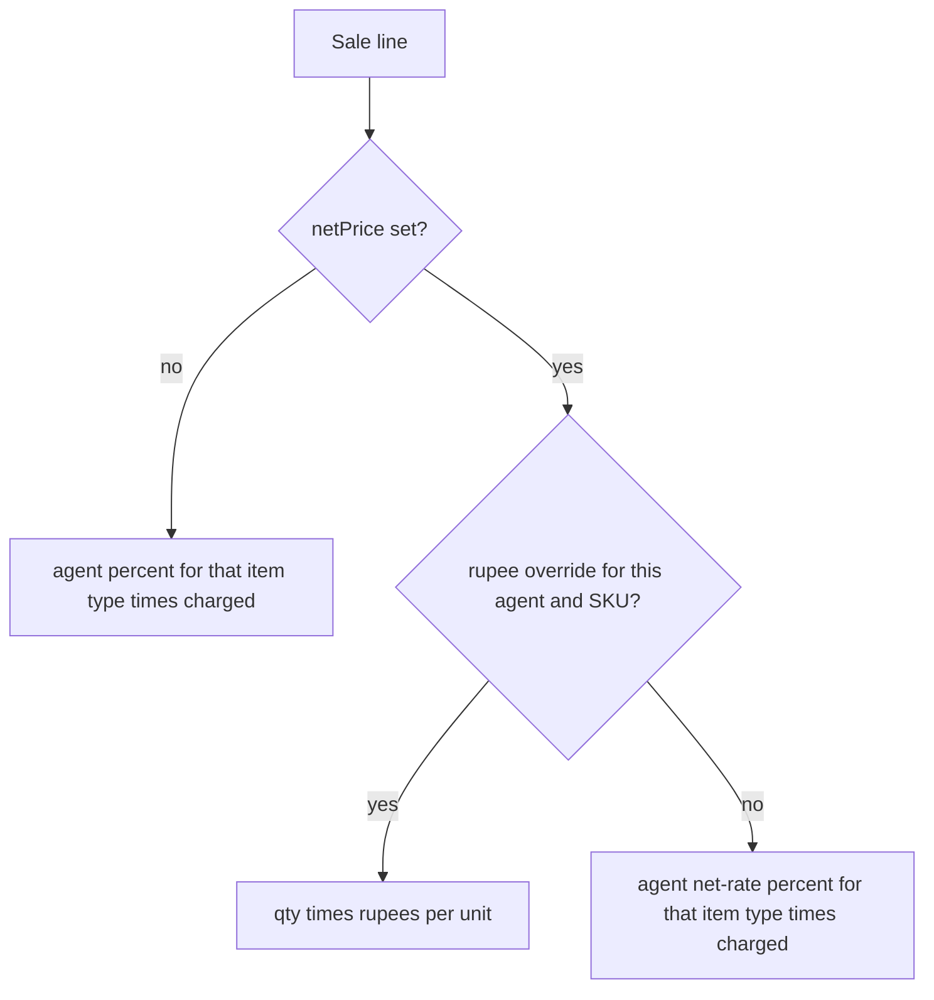

# Agent commission per item type

## What an agent is

Chart rows with `parentId` set. Shop DB has seven, all under Current Asset: AZS, Ijaz, Ilyas, Nadeem, Paper, Shahbaz, Tariq Ali. Customer accounts hang off those heads. Item types are F, T, TT.

Commission is a report. It does not create a journal or a payable. The rate saved today is the rate every date range uses. Changing Ijaz’s T from 5% to 6% rewrites last month’s report.

## How one line is paid

Charged rupees are already defined in `[src/lib/invoiceLineAmount.ts](src/lib/invoiceLineAmount.ts)`: `qty × netPrice` when `netPrice` is set, otherwise `qty × price × (1 − discount/100)`.

Invoice 10348 is the only net-rate sale in the shop DB: Ijaz, GABA, S-23-Z, type T, qty 138, catalog 690, charged 475 (31.16% off). GABA’s profile for T is 28%. That profile is the customer’s discount. It is not the agent’s commission.

If Ijaz’s normal T rate is 5%, his net-rate T rate is 2.5%, and S-23-Z has an override of Rs.5:

- A normal T line uses 5% of charged.
- A net-rate T line with no override uses 2.5% of charged (2.5% × 138 × 475).
- This S-23-Z line uses 138 × 5 = 690. The 2.5% does not apply.

A missing rate counts as 0. The report names every item type on the agent that has no saved row, so a blank setup is not silent.

Purchase invoices, quotations, and sale invoices with `isReturned = 1` are out. A sale return booked as a purchase consignment does not reduce commission. Say so if that should.

Rupee overrides are per agent, and only when `netPrice` is set. The same SKU sold on a normal percent line uses the item-type percent. Rs.5 means per unit, not per invoice line.

## Storage

Migration `047_agent_commissions` in `[src/core/db/migrations](src/core/db/migrations)`. Registered in `[src/core/db/migrations/index.ts](src/core/db/migrations/index.ts)` and `[src/core/db/knownMigrations.ts](src/core/db/knownMigrations.ts)`. Mirrored in `[src/sql/schema.sql](src/sql/schema.sql)` with a `047 migration` comment.

- `agent_type_commissions`: `chartId` + `itemTypeId` unique. `percent` and `netRatePercent`, each 0–100.
- `agent_net_item_commissions`: `chartId` + `inventoryId` unique. `rupeesPerUnit` ≥ 0. Delete row to fall back to type’s net-rate percent.
- `agent_commission_profiles`: `chartId` unique. `payableAccountId` and `expenseAccountId` linking the agent head to their ledger accounts.
- `agent_commission_settlements`: `chartId`, `startDate`, `endDate`, `journalId`, `grossCommission`, `adjustmentsJson`, `netCommission`, `snapshotJson`.

All four tables sync. Appended to `BUSINESS_TABLES` in `[src/core/db/import.ts](src/core/db/import.ts)`. Capture triggers installed via `createCaptureTriggers` from `[034_create_sync_tables.ts](src/core/db/migrations/034_create_sync_tables.ts)`. Added to the `sync_push` allowlist in `[supabase/setup.sql](supabase/setup.sql)`.

## Read and write

New `CommissionService` next to `[PricingService](src/core/services/PricingService.ts)`: prepared statements, `@logErrors`. Save replaces the agent’s type rows and SKU rows in one transaction. Report query joins sale lines to the account on the line (`invoice_items.accountId`, else `invoices.accountId`) and that account’s chart. Item type comes from `inventory.itemTypeId`, not from the `-T` / `-TT` account suffix.

IPC: handler in `main.ts`, method in `preload.ts`, type in `preload.d.ts`.

## Screens

- Accounts: commission editor on an agent head (the seven custom heads). Two columns per item type, Sale % and Net-rate %. A short list to add a SKU and a rupees-per-unit amount. Same save style as `[DiscountsCard.tsx](src/renderer/views/Accounts/AccountPricing/DiscountsCard.tsx)`.
- Reports: Agent commission. Agent picker (same filter as bills aging: `parentId` set), start date, end date. Rows grouped so a rupee SKU is not mixed into its item-type percent bucket. Show qty, charged, rate, commission, and a total. Excel and print follow the grid, same as other reports.

Tests: rate resolution (normal percent, net-rate percent, SKU rupees beating the percent, missing rate = 0), date window, quotation and returned sale excluded, agent scope does not leak another head’s parties. Use `bootstrapDatabase`, not the shop db.
